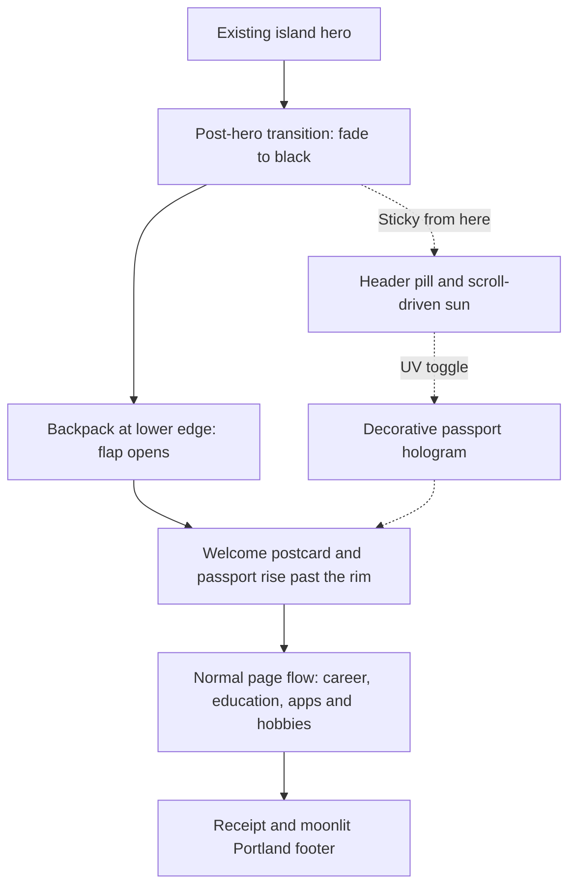

# Pacific Northwest Homepage - Plan

## Goal Capsule

- **Objective** A visitor on a phone can quickly understand Philip’s work and explore a portfolio that feels distinctly Pacific Northwest.
- **Means** Build below the existing island hero with a short backpack reveal and a consistent set of paper surfaces (KTD1, KTD2).
- **Authority** The user’s brief governs the design and page order. The existing site governs résumé facts and behavior. The prototypes supply visual references.
- **Delivery** Three drafts of the same homepage in the PNW workspace. A fresh grader reviews each draft. Present draft 3 and its verification for approval. Production release requires a separate decision.
- **Approval** Implementation starts after Philip gives the go-ahead on this plan.

---

## Product Contract

### Summary

The island leads into a backpack that opens as the visitor scrolls. Its contents become the portfolio. Use warm paper, restrained evergreen and slate accents, and a legible type system across the page. Finish at the moonlit Portland skyline.

### Problem Frame

The island gives the current homepage a strong sense of place. The material beneath it should feel like part of the same site while keeping the résumé, projects, and contact form easy to read and use.

### Key Decisions

- **One passport combines identification and skills.** (session-settled: user-directed — chosen over a separate wallet and ID card: the passport carries both parts.) Governs R4.
- **The island stays above the fold.** (session-settled: user-directed — chosen over a replacement hero: the redesign begins beneath the existing island.) Governs R1, R2.

### Requirements

| ID | Requirement |
| --- | --- |
| R1 | Keep the existing 3D island hero above the fold, including its controls and responsive layout. Keep the saved comparison at `/nov2026island`. |
| R2 | Bring a generated 2D image of the island backpack into the lower edge of the viewport after the hero. Fade the page background to black, open the flap slightly, and make the welcome postcard and passport appear to emerge from the bag as the visitor scrolls. |
| R3 | Make the welcome a postcard with readable handwriting. Keep the existing welcome copy and use regular type for longer passages when it improves reading at phone sizes. Follow the passport with a separate written career postcard. |
| R4 | Put identification on the top page of an open passport and skills stamps below it. Highlight the Anthropic Claude Certified Architect credential using its existing badge and verification link. A UV lamp control reveals holographic details while the page and controls remain readable. |
| R5 | Follow the career postcard with US Letter portrait lined sheets. Put the existing website screenshots in taped Polaroid-style frames above each job’s text and links. |
| R6 | Follow the career with landscape diploma-shaped layouts for MIT and NYU. Keep the existing education facts, links and teaching content. |
| R7 | Follow education with a sheet of postage stamps for the app portfolio, using clean icons and readable names. Then show hobbies as ticket stubs. Keep Toast and add [Sophie the Dog](https://youtube.com/shorts/Jzw1cJRpI6w?feature=share). |
| R8 | Style the existing contact form as a receipt with “Thank you for visiting Phil’s.” Finish with the “Goodnight, Portland.” footer, moon and lit city. Bring in a sticky pill navigation bar after the island hero, with a sun indicator that follows scroll progress. |
| R9 | Design at phone width first. Keep most existing copy and use professional headings, plain language, and consistent spacing and typography across the materials. |
| R10 | Build three successive drafts. After each draft, a fresh grader inspects the running page and reports issues. Use those findings for the next pass and present only draft 3 to Philip. |

### Key Flow

**Visit** Island → backpack opens over the fade to black → welcome postcard → passport ID and skills → career postcard → lined job sheets → diplomas → app stamps → hobby tickets → receipt → Portland at night.

**Navigate** After the first scroll, the pill offers section links and the résumé. The sun shows progress. The UV lamp is a separate control. Section links and browser deep links go directly to the requested content.

### Acceptance Examples

- AE1. On a phone, a slow scroll opens the flap and draws the first paper pieces past the rim. A fast swipe still lands on readable content. Covers R1–R4, R9.
- AE2. Turn the UV lamp on while the passport is visible, then navigate to career and contact. The hologram appears, and labels, links and inputs remain legible. Turn the lamp off and confirm the base treatment returns. Covers R4, R8.
- AE3. Visit the same anchors with reduced motion enabled. All content and controls remain available in page order, including the footer. Covers R2, R8, R9.

### Scope Boundaries

The work targets the editable homepage and its presentation assets. Preserve the archived homepage, site data source, existing résumé download, blog and contact submission behavior. Asset generation is for the backpack. Use existing portfolio imagery and icons where suitable. The approved local preview is the delivery target for this work.

### Sources

- Machine-local [storyboard](/Users/philip/src/skills/creativity-runs/phils-app/storyboard.html). [One Portland Day](/Users/philip/src/skills/creativity-runs/phils-app/small/draft-3/index.html) supplies the pill and the nighttime skyline footer. [Timberline Trail](/Users/philip/src/skills/creativity-runs/phils-app/medium/draft-3/index.html) supplies the lined paper. [Legal Tender](/Users/philip/src/skills/creativity-runs/phils-app/large/draft-2/index.html) supplies the passport, lamp, diploma, stamp, ticket and receipt references. The career Polaroid composition comes from this brief. If the local previews are unavailable, the requirements above govern.
- The existing Astro homepage, the saved island snapshot and the document data in `src/data/imported/` provide the baseline for behavior, copy and facts.

---

## Planning Contract

### Assumptions

- “At the very bottom” means the lower viewport edge at the opening transition. The backpack leaves the screen after the welcome and passport emerge. Later sections keep the same paper treatment in normal page flow.
- “Cloud Certified Architect” refers to the existing **Anthropic Claude Certified Architect** entry. Use that name and its existing Credly URL.
- Use landscape document proportions for the diplomas. Match approved scans if supplied. Otherwise use 11:8.5 as a design proportion and keep lengthy education details below each certificate so the phone layout can wrap naturally.
- Sophie’s ticket can use a matching paw mark until a suitable photo is available. The supplied YouTube URL is the destination. Verify playback during implementation because the planning lookup did not load the video.

### Key Technical Decisions

- KTD1. **One post-hero handoff.** Keep the current hero artwork, canvas and control behavior above the fold. Coordinate the fixed island, title and section-header stacking at the boundary so the backpack and pill have room. Keep the new styles scoped to the editable homepage.
- KTD2. **A layered 2D backpack and real page content.** Use the backpack visible in the island as the visual reference. Generate a registered body and flap through the user’s Codex CLI image workflow after approval. Keep the original render read-only, export lightweight transparent web images, and let the front rim cover the rising edge of the first pieces. Keep the cards in normal document order. Add only the small amount of scroll state needed for the opening and the sun. The effect uses ordinary CSS and the site’s existing scroll patterns.
- KTD3. **UV affects artwork independently of text.** Put the glow, foil and shaded backdrop on decorative layers. Keep text and controls on contrast-tested surfaces in both lamp states and both system themes. Legal Tender darkens the paper itself, so use its holographic marks as the reference and preserve readable ink. [W3C text contrast](https://www.w3.org/WAI/WCAG22/Understanding/contrast-minimum.html)
- KTD4. **HTML carries the résumé.** Keep identification, skills, stamps, credentials and diplomas as real text and links. Use the existing résumé view model for facts and images. Add Sophie as a homepage presentation entry so the finished import data stays intact.
- KTD5. **Reuse existing controls and artwork.** Keep the real `ContactForm` inside the receipt and the existing links in the footer. Adapt the original moon and skyline art from the reference or existing local layers. Load footer imagery below the fold. Style the pill with responsive access to every section, visible focus and safe space around anchor targets.

### High-Level Technical Design

The flow and state sketch is directional. Settle visual timing against the first phone draft.

The default HTML exposes the full page. Reduced-motion mode displays the open backpack and documents as a still composition, with the same content and working navigation. If motion enhancement fails or an image is missing, normal scroll still exposes the content. [W3C guidance on motion from interactions](https://www.w3.org/WAI/WCAG22/Understanding/animation-from-interactions.html)

### Risks and Dependencies

- **Hero overlap** The current fixed island, title, audio controls and section strips persist during scroll. Check stacking at the handoff, while scrolling back and when loading a section link directly.
- **Small text and cropping** Prove the passport and document layouts at narrow phone sizes before adding desktop composition. Long career copy can extend beyond a decorative US Letter minimum height. Diploma supporting text can flow beneath the fixed-ratio panels.
- **Contact behavior** The current form uses Formspree and Turnstile. Give the widget room in the receipt and test with a local stub or intercepted request so a design check does not send an actual message.

---

## Implementation Units

### U1. Protect the island and establish the homepage layout

- **Goal and requirements** Establish the existing hero baseline and a normal-flow design beneath it. R1, R2, R9.
- **Files and pattern** `src/pages/index.astro`, `src/components/IslandHero.astro`, `src/layouts/ParallaxLayout.astro`. Preserve the archive route, archived HTML and its public assets.
- **Approach** Record the baseline at the homepage and archive. Keep the current first-screen layout and controls. Scope the below-fold wrapper and adjust the fixed hero elements only where they hand off to the new layout.
- **Test scenarios** Load both routes at phone and desktop widths. Rotate the live 3D scene and toggle pause. Scroll beyond the hero and back, and load an existing section fragment directly. The archive and first screen retain their behavior, and the new content and nav are reachable.
- **Verification** Compare archived bytes before and after, and verify the handoff in the browser.

### U2. Make the backpack and welcome reveal

- **Goal and requirements** Deliver a brief lower-edge backpack opening and a readable welcome postcard. R2, R3, R9.
- **Dependencies** U1. **Files** `src/pages/index.astro`, new `src/components/BackpackReveal.astro`, new assets under `public/site-assets/pnw/`.
- **Approach** Follow KTD2. Use a readable handwritten face for the greeting and short passages, with a regular text face available for body copy. Prove the timing with the phone layout before adding more motion.
- **Test scenarios** Slow scroll, fast flick, reverse scroll, direct entry below the transition, reduced motion and missing art. The flap lines up with the bag and every visitor can reach and read the welcome and passport at normal scroll speed.
- **Verification** Record the actual scroll in a narrow viewport. Stills supplement the motion check.

### U3. Build the passport and UV lamp

- **Goal and requirements** Combine identification, stamped skills and the featured credential in one readable passport. R4, R9.
- **Dependencies** U1, U2. **Files and pattern** `src/pages/index.astro`, new `src/components/PortfolioPassport.astro`, `scripts/resume-data.test.mjs` if a data mapping changes. Use the existing profile, skills and badge data.
- **Approach** Follow KTD3 and KTD4. Make the lamp a labeled button with an exposed on/off state. Keep the same control accessible when the navigation pill takes over.
- **Test scenarios** Read the passport on a phone and activate the Credly link. Toggle UV by keyboard and touch. Check text and focus contrast in both lamp states and system themes. Verify the cert remains prominent with UV off.
- **Verification** Compare lamp off/on in the browser. Measure at least 4.5:1 for normal text and 3:1 for large text where applicable.

### U4. Design the career and education documents

- **Goal and requirements** Reframe the current career and education content as physical paper. R3, R5, R6, R9.
- **Dependencies** U1. **Files and pattern** `src/pages/index.astro`, `src/components/WorkCard.astro` as the source for existing career props and links, new homepage document styles and markup. Follow collection-based image mapping.
- **Approach** Use a career postcard, then portrait lined pages with a taped screenshot and the job text under it. Use landscape certificate panels for MIT and NYU. Let the biography, publications and teaching details wrap outside the framed area.
- **Test scenarios** Check all career screenshots after scrolling, including high-resolution variants. Verify that long role titles and both diplomas fit at narrow width, and that education and career links still work.
- **Verification** Review the phone stack and the wider layout with the same copy and content order.

### U5. Finish the app stamps, hobby tickets, receipt and footer

- **Goal and requirements** Make the remaining sections and navigation feel like part of the same page. R7–R9.
- **Dependencies** U1, U3. **Files and pattern** `src/pages/index.astro`, `src/components/SiteFooter.astro`, `src/components/ContactForm.astro`, new homepage nav and section markup. Follow existing icon, theme and form patterns.
- **Approach** Follow KTD4 and KTD5. Prefer real project icons with a consistent size and margin. Use a simple icon where a project lacks usable art. Keep all app and hobby names as text. Adapt the Goodnight footer’s moon, lit skyline and link groups, and tie the small sun to page position.
- **Test scenarios** Open representative project links and both dog tickets. Use the pill on phone and desktop, including keyboard access, the résumé link and existing anchors. Check the sun at the start, middle and end. Verify missing-token behavior and submission shape using a local form test.
- **Verification** The footer and contact controls are readable over the nighttime art. Nothing important clips, gets covered by the header or depends on hover.

### U6. Build and grade three drafts

- **Goal and requirements** Improve one coherent design across three passes and deliver draft 3. R1–R10.
- **Dependencies** U1–U5. **Evidence** Save each draft’s revision, preview, screenshots or motion clips, and grader notes in workspace scratch.
- **Draft 1** Build the full page in a phone layout first. Spend the first grading pass on the sequence, backpack reveal, legibility and whether the design feels like one site.
- **Draft 2** Address draft 1 findings and extend the layout to medium and desktop widths. Grade the responsive layout, UV contrast, navigation, visual restraint and browser behavior.
- **Draft 3** Address draft 2 findings and complete the preview. A fresh grader checks the prior findings and the full brief. Fix verified issues in this draft and recheck the affected areas before presenting it.
- **Grader output** For each issue, record severity, viewport, steps to reproduce and evidence. The builder resolves or explains each finding, and verifies fixes. Include concise grading outcomes with the final preview.

---

## Verification Contract

- Run `bun run test` and `bun run build`. Use `scripts/resume-data.test.mjs` if content mapping changes. Browser checks own layout, animation and third-party form integration.
- Use the workspace’s Portless `.dev` URL. Start at 320 and 390 CSS pixels, then check a tablet width and desktop. Verify scrolling, rotation, keyboard focus, touch, text zoom, reduced motion, and both system themes. Spot-check on a real phone if one is available and label any emulated checks.
- Verify the new assets and lazy-loaded screenshots, look for console errors and horizontal overflow, and compare first-fold behavior and the archive against the pre-edit baseline.
- Check all three drafts in a browser. Record any remaining issue by draft and severity. A final preview with a broken required flow is incomplete.

## Definition of Done

- The local homepage follows the requested order and reads as a professional, cohesive PNW portfolio on a phone.
- The hero and comparison archive pass baseline checks. The passport is readable with the lamp on, and the receipt uses the live form behavior with verification performed against a local substitute.
- Three drafts have independent grading evidence. Draft 3 has verified fixes and a preview to review. Remove unused experiment assets and styles from the final change set.
